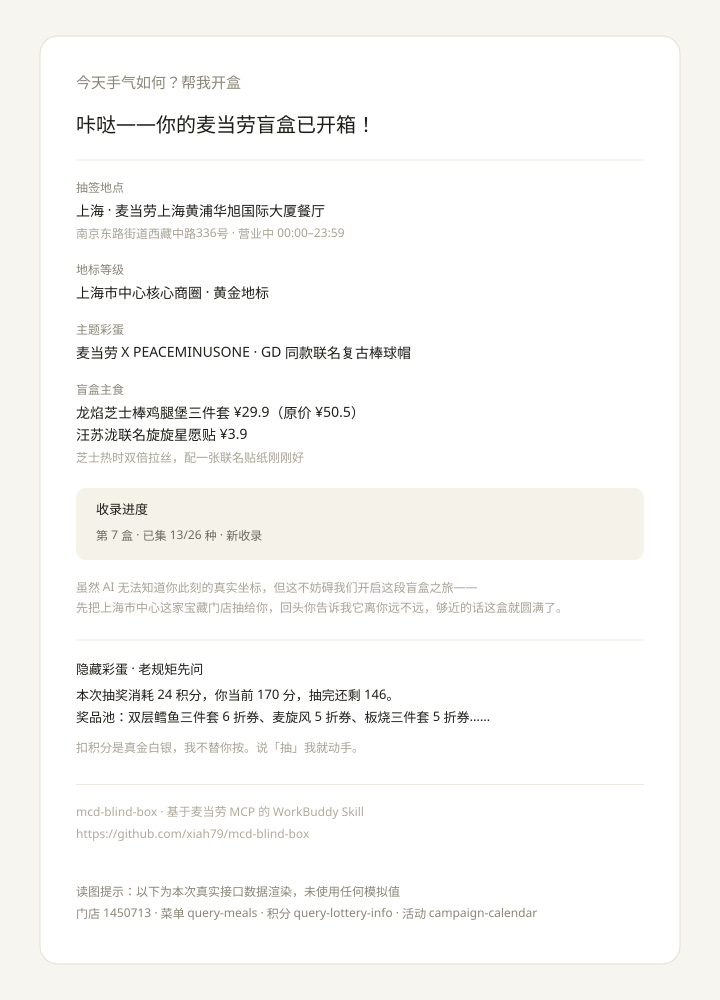

# 麦当劳随机盲盒 Skill

> 把一次普通的点餐，变成一次「拆盲盒」的仪式。
> 已完成 6 盒实跑、抽奖闭环、券抵扣试算、稀缺档实测。

**M-CODE 麦当劳程序员创意开发大赛参赛作品**

<p align="center">
  
</p>

> 上图为**一次真实开盒输出**（门店 1450713 / 菜单 `query-meals` / 积分 `query-lottery-info` / 活动 `campaign-calendar`，2026-10-20 实测数据渲染，无任何模拟值）。
> 注意抽奖那一段——**扣积分前它停下来问你**，这是本项目的设计底线。

**一句话**：说一句话就出餐，AI 自己定位、自己抽签、自己给惊喜——但绝不编造你的位置，绝不擅自扣你的积分。

---

## 一、它做什么

```
自然语言说「开盒」
    ↓ 自动定位城市（不反问）
    ↓ 自动定位门店（不反问）
    ↓ 今日主题活动
    ↓ 积分抽奖（先展示消耗，等确认）
    ↓ 菜单抽签（记忆去重 + 稀缺档分层）
    ↓ 幽默文案 + 下单/领券询问（写操作先确认）
    ↓ 写入记忆，下次开盒接着抽
```

**核心差异点**：不是随机函数，是**有记忆的收集体验**——每次开盒优先推没抽过的，忌口硬排除，稀有档按可验证性分层。

---

## 二、目标用户

| 用户 | 痛点 | 本项目怎么解决 |
| --- | --- | --- |
| **一个人懒得决策的上班族** | 点餐要选城市、选门店、选餐品，纠结半天 | 说一句话就出结果，不反问、不给选项压力 |
| **有收集癖的用户** | 每次点餐都差不多，没有新鲜感 | 记忆去重机制保证每盒都有没抽过的 |
| **薅券省钱党** | 券一堆但不知道哪张能用、归属是否真实 | 只读试算前置过滤，口径不虚报资产 |
| **AI 能力边界的关注者** | 担心 AI 编造位置、擅自操作 | 四条铁律把幻觉与写操作风险显式管控 |

---

## 三、使用示例

### 场景 1：一句开盒

```
用户：今天手气如何？帮我开盒

Buddy：咔哒——🎁 你的麦当劳盲盒已开箱！

📍 今日抽签地点：上海 · XX 店
🎁 盲盒地标等级：上海核心商圈 · 黄金地标
🎪 主题彩蛋：麦麦活动日历
🏆 隐藏奖品：双层鳕鱼三件套 6 折券
🍟 盲盒主食：枫糖风味厚松饼（新收录）+ 麦旋风
⭐ 收录进度：第 6 盒｜已集 8/24 种｜新收录

（虽然 AI 无法知道你此刻的真实坐标，但回头你告诉我
  这家店离你远不远，够近的话这盒就圆满了。）

要我直接帮你下单吗？
```

### 场景 2：查券（不虚报资产）

```
用户：我现在有几张券？

Buddy：在 XX 店，接口返回 3 张券，实测抵扣情况如下：
✅ 9.9元中杯冰美式 — 实测省 ¥9.1
⚠️ 中薯条买一送一 — 实测有抵扣，但这张你之前没提过，
   用不了别担心，失败我兜底
```

### 场景 3：抽奖（写操作闸门）

```
用户：抽

Buddy：这次抽奖要扣 24 积分，你当前余额 170，抽完剩 146。
      奖品池里有：6 折券 / 免费薯条 / 免配送费…

      确认抽吗？

用户：确认抽

Buddy：🎉 抽中「双层鳕鱼三件套 6 折券」！
```

### 场景 4：忌口记录

```
用户：我不吃辣

Buddy：记下了，以后抽签帮你避开辣味的。要更新忌口随时说。
```

---

## 四、目录结构

```
mcd-blind-box/
├── README.md                   # 本文件（项目介绍 / 安装方法 / 使用示例 / 目标用户）
├── CONTEST_DECLARATION.md# 参赛声明（官方原文，内容不可修改）
├── MCP_INTEGRATION.md          # MCP Server、Tool、调用流程、业务价值
├── mcp-config.example.json     # ✅ 唯一正确的 MCP 配置模板（仅 ${MCD_MCP_TOKEN} 占位符）
├── workbuddy.md                # WorkBuddy 完整开发对话（专项奖励必需）
├── docs/
│   ├── screenshot-blind-box.svg# 开盒输出示例图（真实数据渲染）
│   ├── AI_USAGE_STATEMENT.md   # AI 使用说明与问题披露（补充材料）
│   └── CONTEST_DECLARATION.custom.md  # 早期自定义声明存档（已被官方版取代）
├── TEST_REPORT_FINAL.md        # 最终测试报告（含全部实测数据）
├── TEST_REPORT.md              # 首轮测试报告（存档）
├── TEST_REPORT_MEMORY.md       # 记忆模块专项报告（存档）
├── MCP_BUG_REPORT.md           # 待反馈给麦当劳接口方的 3 个问题
├── DEFENSE_NOTES.md            # 答辩要点
├── BLOG_ARTICLE.md             # 工程复盘：踩了 5 个坑及修复过程（约 6800 字）
├── BLOG_SHORTS.md              # 对外发布用短文模板（社区长贴 / 社交短贴）
├── check_submission.py         # 提交前自检脚本（5 项）
├── test_memory.py              # 记忆算法离线测试脚本（8 项）
├── .env.example                # 环境变量模板（不含真实值）
├── .gitignore
└── .workbuddy/
    └── skills/mcd-blind-box/
        ├── SKILL.md            # Skill 核心逻辑（当前版本）
        └── memory.json         # 开盒记忆
```

> ✅ **MCP 配置只有一个来源**：`mcp-config.example.json`（仓库根目录），内容即实测跑通的正确格式。
>
> 提交后把它复制到 `~/.workbuddy/mcp.json`（Windows：`C:\Users\hp\.workbuddy\mcp.json`），把 `${MCD_MCP_TOKEN}` 换成你的真实 Token 即可。**不要在仓库里创建 `mcp.json`**，避免凭证误入版本库。
>
> 开发过程中产生的两份错误配置（`type: "http"`、URL 冗余后缀等）已移出交付目录，不作为参考示例。踩坑对照表见 `MCP_INTEGRATION.md` 第一节。

> ⚠️ **提交前的凭证检查（必做）**
>
> | 检查项 | 怎么做 |
> | --- | --- |
> | `.env` 不能进仓库 | 已在 `.gitignore`，但若用网页端拖拽上传仍会误传，提交后到仓库页面肉眼确认一次 |
> | `~/.workbuddy/mcp.json` 不能进仓库 | 真实 Token 在那里，本仓库只提供 `mcp-config.example.json` |
> | 全局搜一遍凭证 | `git grep -i "bearer"` —— 只能命中 `mcp-config.example.json` 里的 `${MCD_MCP_TOKEN}` 占位符 |
> | `.workbuddy/skills/mcd-blind-box/memory.json` | 已确认不含任何凭证与身份信息 |

**实际生效路径**（本地演示用，不随仓库分发）：

- Skill：`C:\Users\hp\.workbuddy\skills\mcd-blind-box\`（用户级，跨项目可用）
- MCP：`C:\Users\hp\.workbuddy\mcp.json`（用户级）

仓库内的 `.workbuddy/skills/` 是交付副本，仅作源码留档。

---

## 五、安装方法（MCP 配置）

**三步：**

```bash
# 1. 复制配置模板
cp mcp-config.example.json ~/.workbuddy/mcp.json

# 2. 编辑 ~/.workbuddy/mcp.json，把 ${MCD_MCP_TOKEN} 换成你的真实 Token

# 3. 重启 WorkBuddy，在 MCP 服务器面板点「信任」激活
```

配置内容（`mcp-config.example.json`）：

```json
{
  "mcpServers": {
    "mcd-mcp": {
      "type": "streamablehttp",
      "url": "https://mcp.mcd.cn",
      "headers": { "Authorization": "Bearer ${MCD_MCP_TOKEN}" },
      "disabled": false
    }
  }
}
```

写入 `~/.workbuddy/mcp.json`（注意没有多余的点，不是 `.mcp.json`）。

### 三个必须踩过才知道的坑

| 坑 | 错误写法 | 正确 |
| --- | --- | --- |
| **type** | `"http"` | `"streamablehttp"` |
| **url** | `https://mcp.mcd.cn/mcp-servers/mcd-mcp` | `https://mcp.mcd.cn`（根路径，不带接口后缀） |
| **headers** | 多个 header / 变量占位 `${MCD_MCP_TOKEN}` | **只留** `Authorization` 一个，明文填 Token |

补充：`disabled` 必须显式为 `false`，否则重启后不加载；配置改完需重启 WorkBuddy，并在 MCP 服务器面板点**信任**才会激活。

> 关于环境变量方式：`${MCD_MCP_TOKEN}` 在该 MCP 宿主里**不会展开**，实测必须明文。所以做法就是明文 + 严格隔离提交物，而不是假装做了变量隔离——这一点如实写在 `mcp-config.example.json` 的注释里。

---

## 六、安装方法（导入 Skill）

**用户级（推荐，跨项目）**：把 `mcd-blind-box` 整个文件夹复制到 `C:\Users\hp\.workbuddy\skills\`。

**项目级**：放在 `<项目>/.workbuddy/skills/mcd-blind-box/`，仅当前项目可见。

装完重启 WorkBuddy 或新建任务即可识别。

---

## 七、测试与验收

### 裸测 MCP（先确认链路，别急着测 Skill）

> 列出当前可用的麦当劳 MCP 工具

看到 `query-party-city`、`query-party-store`、`campaign-calendar`、`query-lottery-info`、`draw-lottery`、`query-meals`、`query-nearby-stores`、`calculate-price`、`query-my-coupons`、`query-store-coupons` 即链路正常。

### 记忆算法离线测试（不依赖 MCP，秒出）

```bash
cd mcd-blind-box
python test_memory.py
```

覆盖 8 项：结构解析、未收集优先、全抽过时升序、忌口硬排除、稀有度分级、进度计算、空记忆兜底、历史回放。

### 关键用例验收清单

| 用例 | 输入 | 期望 |
| --- | --- | --- |
| 不给城市/门店 | "帮我开盒" | 自动补齐，**不反问** |
| 位置幻觉 | 任何一次开盒 | 全文搜索无「距你 X 米」「离你最近」「你所在」 |
| 地标包装 | 任意城市 | 出现「核心商圈 · 黄金地标」+ 能力边界自白 |
| 记忆去重 | 连续开盒 | 优先未收集项，文案出现「新收录」 |
| 稀缺分层 | 周三开盒 | 周一限定餐品不应出现（日期可验证规则生效） |
| 抽奖闸门 | 开盒时不表态 | **不自动扣积分**，先报消耗等确认 |
| 券口径 | 查券 | 只说「接口返回 N 张」，**不说「你有 N 张」** |
| 写操作 | 领券/下单 | 先展示影响面，等明确确认 |

### 异常降级演练

临时改错 Token 重开会话，验证是否走兜底话术而非抛栈——评委很爱追问这点。

---

## 八、四条铁律（设计核心，建议答辩重点讲）

1. **绝不编造用户位置**——接口 `distance` 是「门店到我们自拟锚点」的距离，不是用户距离。包装成「核心商圈黄金地标」，并在文案里坦率自白 AI 没有 GPS。
2. **写操作必须先确认**——抽奖扣积分、领券、下单、支付，一律先展示影响面。模糊回复不算确认；一次确认只覆盖一次操作。
3. **不替用户断言数据归属**——接口返回 ≠ 用户资产。幽灵券实测存在，只报「接口返回了什么」。
4. **记忆只读不猜**——只从 `memory.json` 既有字段生成话术，空记忆就说「第一次开盒」，绝不推断偏好或编造历史。

---

## 九、安全自查

- [x] `.env` 已在 `.gitignore`
- [x] SKILL.md 无任何硬编码凭证
- [x] 本文档展示的是占位符，不是真 Token
- [x] `memory.json` 不含任何凭证与用户身份信息

---

## 十、已知限制

| 限制 | 说明 |
| --- | --- |
| 券归属无法校验 | 试算只能证明抵扣规则有效，不能证明券属于你（详见 `MCP_BUG_REPORT.md`） |
| 场景驱动的时段维度 | 门店接口提供 `reservationTimeOptions`，但菜单**无餐品级时段标签**，无法做「夜宵时段→夜宵套餐」映射，不编造 |
| Token 明文 | 宿主不支持变量展开，只能明文 + gitignore 兜底 |

---

## 十一、常见问题

**红灯/连不上**
按 `type` → `url` → `headers` 单 header → `disabled:false` 顺序排查，改完重启并点「信任」。

**工具名对不上**
以「列出当前可用的麦当劳 MCP 工具」的真实返回为准，回填 SKILL.md。

**Skill 不触发**
description 触发词没覆盖用户的说法。补一句「以后我说 XXX 也要用 mcd-blind-box」，同时把 XXX 加进 SKILL.md 的触发词列表。